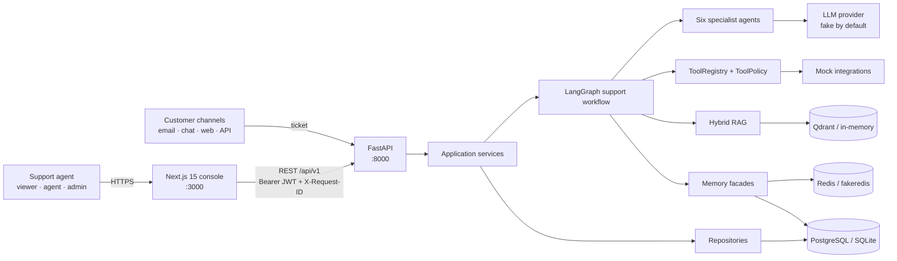
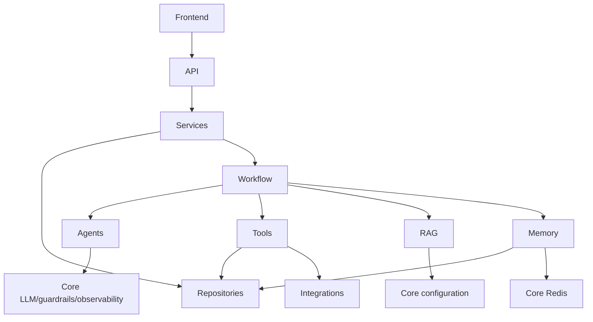
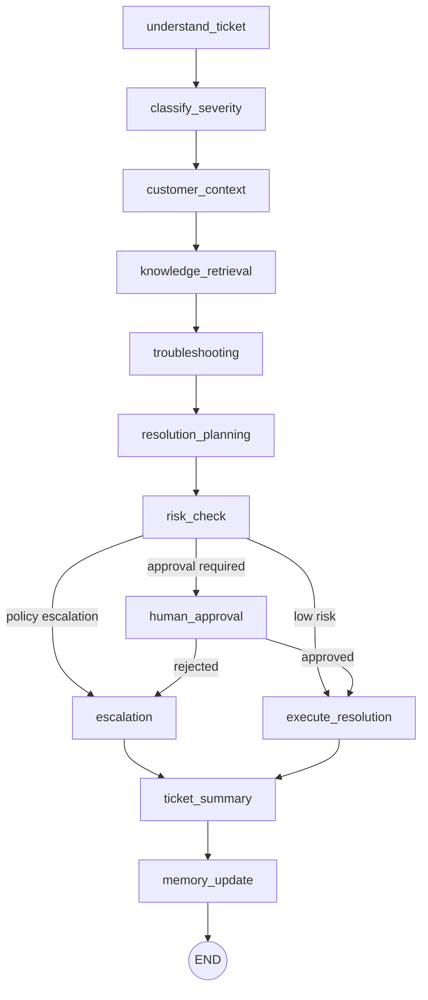
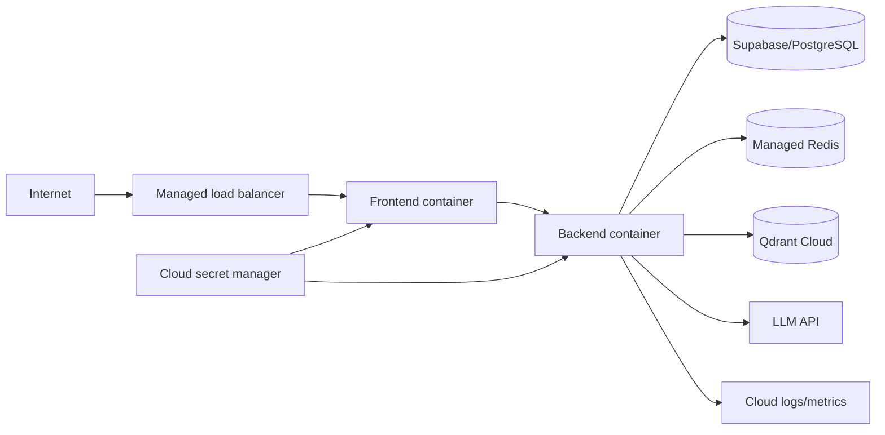

# CloudDesk architecture

Architecture reference for the Autonomous Customer Support & Resolution Platform. `CLAUDE.md` remains authoritative. This document describes the target design; consult `MEMORY.md` for what is actually implemented or deployed.

## System context

CloudDesk is an internal support-agent console. Customers create tickets through mocked email, chat, web, or API channels; support staff inspect and control an AI-assisted resolution workflow. Consequential actions remain human-gated.



## Runtime components

| Component | Responsibility | Boundary |
|---|---|---|
| Next.js console | Authentication UI, lists, ticket workspace, workflow polling, approval controls | Calls only `frontend/lib/api.ts`; never receives a service-role key |
| FastAPI API | HTTP validation, JWT/RBAC, middleware, background-task entrypoints | Contains no business policy |
| Services | Coordinate repositories, graph runs, approval resume, and seed operations | No HTTP concerns |
| Repositories | All SQLAlchemy persistence | No LLM or HTTP calls |
| LangGraph workflow | Execute and persist the ticket-resolution state machine | Nodes return partial state only |
| Specialist agents | Classification, context, knowledge, diagnosis, resolution, escalation | Structured outputs; no direct SQL |
| Rules and guardrails | Deterministic policy, injection defense, output validation, scrubbing | Rules override model judgment |
| Tool registry | Enforce allow-list, timeout, approval state, and uniform results | Every tool invocation passes through it |
| RAG | Load, chunk, index, retrieve, fuse, and rerank knowledge | Does not know ticket persistence |
| Memory | Short-term Redis and durable customer-note facades | Never stores secrets or raw ticket bodies |
| Integrations | Protocols and mock external services | Core does not import integrations |

## Dependency direction



Forbidden dependencies include repositories calling LLMs, agents writing SQL, API handlers containing policy, tools bypassing the registry, RAG importing ticket code, integrations imported by core, and frontend code holding backend secrets.

## Ticket workflow



The graph persists state after every node. `errors` and `completed_nodes` append through reducers. Code before `interrupt()` must be small and idempotent because it runs again on resume.

## Run and approval sequence

```mermaid
sequenceDiagram
    actor A as Support agent
    participant UI as Next.js
    participant API as FastAPI
    participant S as Workflow service
    participant G as LangGraph
    participant DB as SQL/checkpointer

    A->>UI: Run workflow
    UI->>API: POST /tickets/{id}/run
    API->>S: create_run()
    S->>DB: Insert workflow_run
    API-->>UI: 202 {workflow_id}
    S->>G: start_workflow(state)
    loop after every node
        G->>DB: Save state and workflow events
        UI->>API: GET /tickets/{id}/workflow
        API-->>UI: Current progress
    end
    G->>G: interrupt() at human_approval
    S->>DB: Create approval; ticket = waiting_on_approval
    A->>UI: Approve or reject
    UI->>API: POST /approvals/{id}/approve or /reject
    API->>G: Command(resume=decision)
    G->>DB: Execute or escalate, summarize, update memory
```

## Data and state

Primary tables are `profiles`, `customers`, `subscriptions`, `workspaces`, `products`, `tickets`, `ticket_messages`, `support_articles`, `incidents`, `workflow_runs`, `workflow_events`, `resolution_actions`, `approval_requests`, `escalations`, `customer_memory`, and `audit_logs`.

- SQLAlchemy uses portable JSON and `String(36)` UUIDs for SQLite/PostgreSQL parity.
- PostgreSQL DDL and RLS live under `database/`; `database/schema.sql` becomes authoritative once implemented.
- Workflow state is persisted in `workflow_runs.state`; node/tool/model history is append-only in `workflow_events`.
- Short-term ticket state and retrieval caching live in Redis/fakeredis.
- Knowledge vectors live in Qdrant or the in-memory implementation behind `VectorStoreService`.

## Security boundaries

- Bearer JWT establishes identity; `require_role` enforces `viewer < agent < admin`.
- Request-ID, rate-limit, and audit middleware apply to API traffic; every non-GET request is audited.
- Customer-controlled content is delimited with `wrap_untrusted` and scanned for injection patterns.
- Customer-facing output is blocked if it contains secrets, internal URLs, or another customer's data.
- Refunds, deletions, disputes, and workspace-setting changes cannot execute without the defined approval/escalation policy.
- Secrets are server-side environment values only and never enter logs, prompts exposed to operators, memory notes, frontend bundles, or Git.

## Deployment topology



AWS maps to ECR/ECS Fargate/ALB/Secrets Manager/CloudWatch; Azure maps to ACR/Container Apps/Key Vault/Log Analytics; GCP maps to Artifact Registry/Cloud Run/Secret Manager/Cloud Logging. Terraform files describe deployability; only `MEMORY.md` may record whether any environment was actually applied.

## Observability

Every log line carries `request_id` and, when relevant, `workflow_id`. `WorkflowTracer` records node start/completion, tool calls, model calls, approval events, errors, and completion, including duration, token usage, and estimated cost. Telemetry failures never fail the workflow. Raw prompts, hidden reasoning, secrets, and cross-customer data are never exposed.

