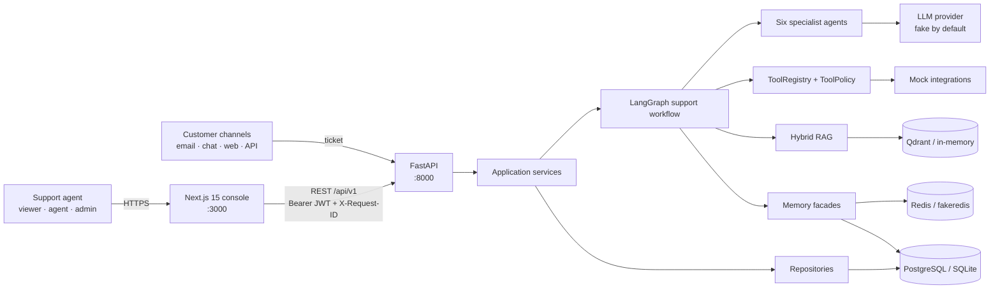
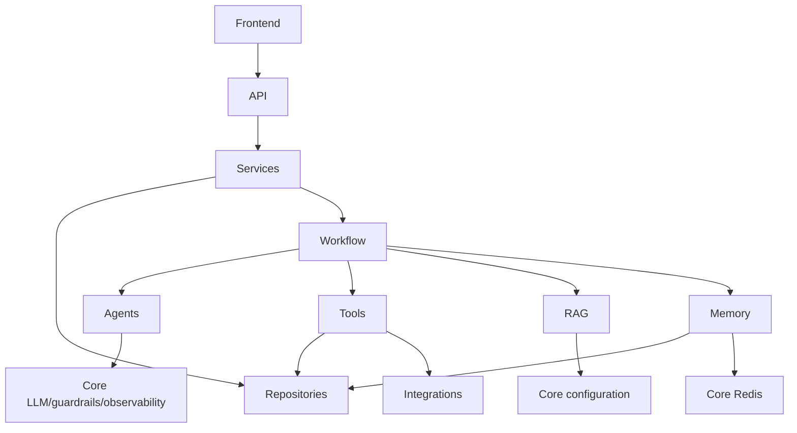
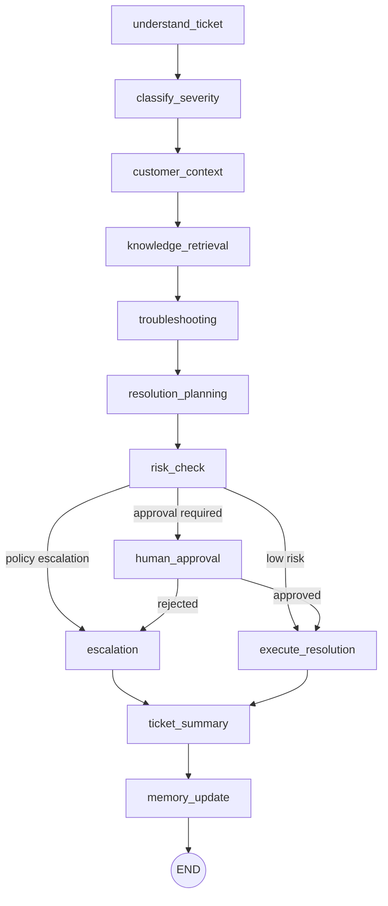
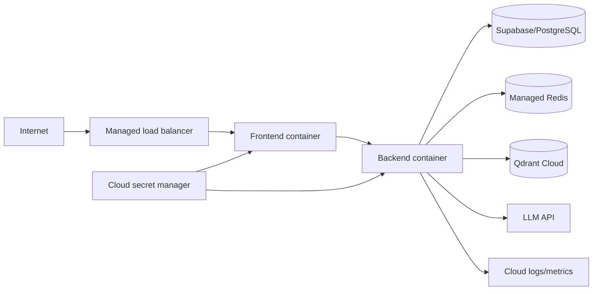

# CloudDesk architecture

Architecture reference for the Autonomous Customer Support & Resolution Platform. `CLAUDE.md` remains authoritative. This document describes the target design; consult `MEMORY.md` for what is actually implemented or deployed.

## System context

CloudDesk is an internal support-agent console. Customers create tickets through mocked email, chat, web, or API channels; support staff inspect and control an AI-assisted resolution workflow. Consequential actions remain human-gated.



## Runtime components

| Component | Responsibility | Boundary |
|---|---|---|
| Next.js console | Authentication UI, lists, ticket workspace, workflow polling, approval controls | Calls only `frontend/lib/api.ts`; never receives a service-role key |
| FastAPI API | HTTP validation, JWT/RBAC, middleware, background-task entrypoints | Contains no business policy |
| Services | Coordinate repositories, graph runs, approval resume, and seed operations | No HTTP concerns |
| Repositories | All SQLAlchemy persistence | No LLM or HTTP calls |
| LangGraph workflow | Execute and persist the ticket-resolution state machine | Nodes return partial state only |
| Specialist agents | Classification, context, knowledge, diagnosis, resolution, escalation | Structured outputs; no direct SQL |
| Rules and guardrails | Deterministic policy, injection defense, output validation, scrubbing | Rules override model judgment |
| Tool registry | Enforce allow-list, timeout, approval state, and uniform results | Every tool invocation passes through it |
| RAG | Load, chunk, index, retrieve, fuse, and rerank knowledge | Does not know ticket persistence |
| Memory | Short-term Redis and durable customer-note facades | Never stores secrets or raw ticket bodies |
| Integrations | Protocols and mock external services | Core does not import integrations |

## Dependency direction



Forbidden dependencies include repositories calling LLMs, agents writing SQL, API handlers containing policy, tools bypassing the registry, RAG importing ticket code, integrations imported by core, and frontend code holding backend secrets.

## Structured LLM boundary

P9-1 defines strict workflow Pydantic models in `backend.app.schemas.workflow` and routes every future
model call through `backend.app.core.llm.call_structured`. That boundary validates output, retries only
bounded provider or validation failures, and returns token usage, duration, provider/model identity,
attempt count, and estimated cost without exposing raw prompts. `FakeLLM` produces deterministic valid
outputs offline, needs no API key, reports zero cost, and emits no planned actions because actions are
owned by deterministic policy. Non-fake providers fail closed until an explicit adapter is added.

## Support supervisor boundary

P9-2 implements `agents.specialists.SupervisorAgent` for F2, F3, and the future F11 summary node.
Subjects, bodies, workflow outcomes, and follow-up text are wrapped as untrusted data before every
model call. Classification retains injection signal names for later risk routing, while narrow
deterministic rules enforce security, billing-dispute, and account-deletion categories when model
judgement conflicts with policy. Severity is model-assisted but `rule_severity` can only raise the
result. The specialist returns validated output plus token, duration, cost, provider, attempt,
injection, and applied-policy metadata; it neither calls tools nor writes persistence directly.

## Customer-context specialist boundary

P9-3 implements `agents.specialists.CustomerAgent` as a deterministic F4 assembler with no LLM call.
It obtains customer identity and workspace, subscription, and up to ten previous tickets only through
`ToolRegistry.execute`, while up to ten scrubbed durable notes come through the memory facade. Tool
payloads are explicitly projected into strict workflow schemas, the current ticket is excluded from
history, and customer ownership is rechecked across subscription, history, and memory results before
state is returned. The agent reports tool-call timing data with zero tokens and zero model cost; it
does not import repositories or access SQL directly.

## Knowledge specialist boundary

P9-4 implements `agents.specialists.KnowledgeAgent` for F5 and F6 without an LLM call. Knowledge-base
retrieval always passes through `ToolRegistry.execute("search_docs", ...)`, preserving the existing
hybrid semantic/BM25 fusion, heuristic reranking, cache, and citation boundary. The specialist
projects only strict `Evidence` fields, deduplicates by article, and returns at most ten results.
Caller-supplied resolved cases are ranked independently using deterministic token-set Jaccard overlap
with stable tie-breaking. Tool failures fail closed, and the result exposes traceable tool metadata
with zero tokens and zero model cost.

## Secret-scrubbing boundary

`backend.app.core.guardrails.scrub` is the deterministic N7 boundary for text that may later enter
durable memory. It reuses the same centralized secret patterns as customer-output validation, checks
payment-card candidates with Luhn, and removes complete private-key blocks and credential-bearing
URLs. Matches are collected against the original input, overlapping spans are merged, and each span
is replaced with the generic `[REDACTED]` marker. This keeps replacement stable and idempotent without
returning or logging the matched secret. Future memory writers must call `scrub` before persistence.

## Tool execution boundary

`ToolPolicy` classifies every known capability before execution. Read-only lookups, routine ticket
updates, and the safe escalation path do not need approval; refund requests and workspace-setting
resets do. Unclassified registered extensions default to approval-required, while unregistered names
never execute. `ToolRegistry.execute(name, args, approved=...)` is the shared automatic and
human-approved path. It accepts only asynchronous LangChain `@tool` definitions, enforces
`TOOL_TIMEOUT_SECONDS`, and converts timeouts or exceptions into scrubbed `ToolResult` values so a
tool adapter cannot crash the workflow.

P6-2 registers five read-only capabilities through a dependency-injected factory. Customer and
subscription lookups expose safe projections, ticket history is capped at ten and omits bodies and
messages, document search reuses the cited hybrid retriever, and service status uses a replaceable
`ServiceStatusProvider`. The repository-backed provider can read seeded incidents without changing
tool names, policy, or execution flow.

P6-3 adds four write capabilities on the same boundary. `update_ticket` limits routine mutations to
status, category, severity, and summary. `create_escalation` transactionally creates the safe fallback,
marks the ticket escalated, and reuses an identical open escalation. Refund requests and demo-setting
resets delegate to injected provider protocols only after `ToolRegistry.execute(..., approved=True)`
passes policy. Money uses `Decimal`, and refund calls require an idempotency key.

P6-4 implements those protocols with deterministic, stateful in-memory mocks. Refund requests use
stable IDs and reject conflicting idempotency-key reuse while explicitly reporting that no money was
moved. Workspace changes remain in process and report that no external account changed. Service
status loads validated checked-in incidents. `create_integrations` selects this provider set only in
demo mode and otherwise fails closed; `create_support_tool_registry` composes all nine tools around
one provider set and one `ToolRegistry` execution boundary.

## Deterministic escalation and severity policy

P7-1 places model-independent safety policy in `agents/rules.py`. One ordered immutable rule table
covers security incidents, data loss, account deletion, payment disputes, explicit legal requests,
and enterprise-wide outages. Every rule names its destination team, explanation, and minimum
severity. `matching_escalation_rules` returns all policy evidence in stable routing order, while
`policy_escalation` uses the first match for ownership and the highest matched severity for priority.
`rule_severity` can raise a model assessment to that deterministic minimum but can never lower it.
This keeps mandatory routing explainable and leaves only unmatched grey areas for later model
judgement.

## Ticket workflow



The graph persists state after every node. `errors` and `completed_nodes` append through reducers. Code before `interrupt()` must be small and idempotent because it runs again on resume.

## Run and approval sequence

```mermaid
sequenceDiagram
    actor A as Support agent
    participant UI as Next.js
    participant API as FastAPI
    participant S as Workflow service
    participant G as LangGraph
    participant DB as SQL/checkpointer

    A->>UI: Run workflow
    UI->>API: POST /tickets/{id}/run
    API->>S: create_run()
    S->>DB: Insert workflow_run
    API-->>UI: 202 {workflow_id}
    S->>G: start_workflow(state)
    loop after every node
        G->>DB: Save state and workflow events
        UI->>API: GET /tickets/{id}/workflow
        API-->>UI: Current progress
    end
    G->>G: interrupt() at human_approval
    S->>DB: Create approval; ticket = waiting_on_approval
    A->>UI: Approve or reject
    UI->>API: POST /approvals/{id}/approve or /reject
    API->>G: Command(resume=decision)
    G->>DB: Execute or escalate, summarize, update memory
```

## Data and state

Primary tables are `profiles`, `customers`, `subscriptions`, `workspaces`, `products`, `tickets`, `ticket_messages`, `support_articles`, `incidents`, `workflow_runs`, `workflow_events`, `resolution_actions`, `approval_requests`, `escalations`, `customer_memory`, and `audit_logs`.

- SQLAlchemy uses portable JSON and `String(36)` UUIDs for SQLite/PostgreSQL parity.
- PostgreSQL DDL and RLS live under `database/`; `database/schema.sql` becomes authoritative once implemented.
- Workflow state is persisted in `workflow_runs.state`; node/tool/model history is append-only in `workflow_events`.
- Short-term ticket state and retrieval caching live in Redis/fakeredis.
- Knowledge vectors live in Qdrant or the in-memory implementation behind `VectorStoreService`.

P8-1 places short-term conversation and workflow context behind `memory.ShortTermMemory`. Conversation
messages are appended in order to ticket-scoped Redis lists, while the latest workflow snapshot is a
ticket-scoped JSON string. Every write applies or refreshes a 24-hour TTL. The facade validates ticket
identifiers before constructing keys, tolerates malformed ephemeral entries without crossing ticket
boundaries, supports explicit per-ticket cleanup, and accepts the shared Redis client or fakeredis by
dependency injection.

P8-2 makes `memory.LongTermMemory` the application write boundary for durable customer notes. Content
is scrubbed before storage and SHA-256 fingerprinting; the existing unique constraint on customer,
memory type, and fingerprint suppresses exact duplicates. Source tickets and workflows must belong to
the same customer, and an exact raw source-ticket body is rejected. Recall returns at most ten newest
notes through a projection that excludes fingerprints and internal attributes. The caller retains
transaction ownership so later workflow orchestration can commit all memory updates atomically.

P8-3 exposes `recall_customer` and `record_resolution` through `memory.MemoryService` for future graph
nodes. Recall remains capped at ten notes. Resolution recording uses one savepoint to write a past
issue, one numbered troubleshooting note containing at most the first three non-blank steps, and one
resolution note. Any failure rolls back the group, while replaying identical content reuses existing
fingerprinted rows. The graph-node calls themselves remain pending with the workflow phase.

## Security boundaries

- Bearer JWT establishes identity; `require_role` enforces `viewer < agent < admin`.
- Request-ID, rate-limit, and audit middleware apply to API traffic; every non-GET request is audited.
- Customer-controlled content is scanned by deterministic N4 patterns before model use. The scanner
  normalizes Unicode and zero-width obfuscation and returns stable signal names for auditability.
- `wrap_untrusted` XML-escapes content and source labels inside one `<untrusted_content>` block, so
  injected closing tags cannot escape the data boundary. Every future specialist prompt shares
  `SECURITY_PREAMBLE`, which forbids obeying embedded instructions, revealing prompts or secrets,
  invoking tools, or changing workflow routing because customer-controlled text asks.
- Customer-facing output receives a structured validation result before display. Empty output,
  internal/private URLs, secret classes, and explicitly supplied other-customer identifiers produce
  generic violation codes without echoing matched data; every failure is invalid and `high` risk.
  Public documentation links and identifiers belonging to the current customer remain allowed.
- Refunds, deletions, disputes, and workspace-setting changes cannot execute without the defined approval/escalation policy.
- Secrets are server-side environment values only and never enter logs, prompts exposed to operators, memory notes, frontend bundles, or Git.

## Deployment topology



AWS maps to ECR/ECS Fargate/ALB/Secrets Manager/CloudWatch; Azure maps to ACR/Container Apps/Key Vault/Log Analytics; GCP maps to Artifact Registry/Cloud Run/Secret Manager/Cloud Logging. Terraform files describe deployability; only `MEMORY.md` may record whether any environment was actually applied.

## Observability

Every log line carries `request_id` and, when relevant, `workflow_id`. `WorkflowTracer` records node start/completion, tool calls, model calls, approval events, errors, and completion, including duration, token usage, and estimated cost. Telemetry failures never fail the workflow. Raw prompts, hidden reasoning, secrets, and cross-customer data are never exposed.

