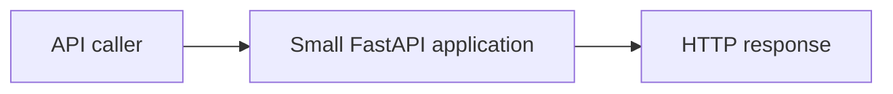
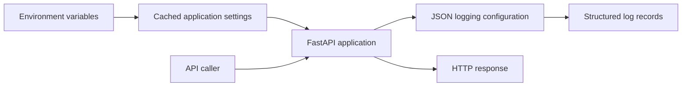
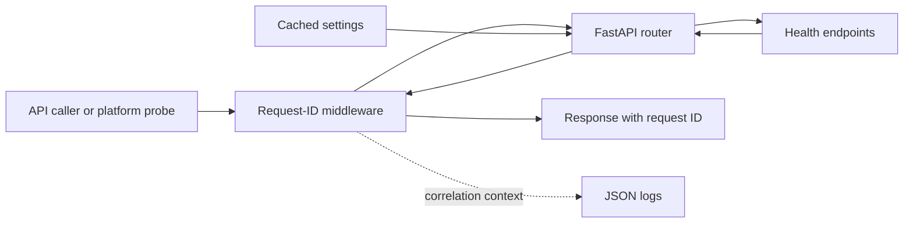
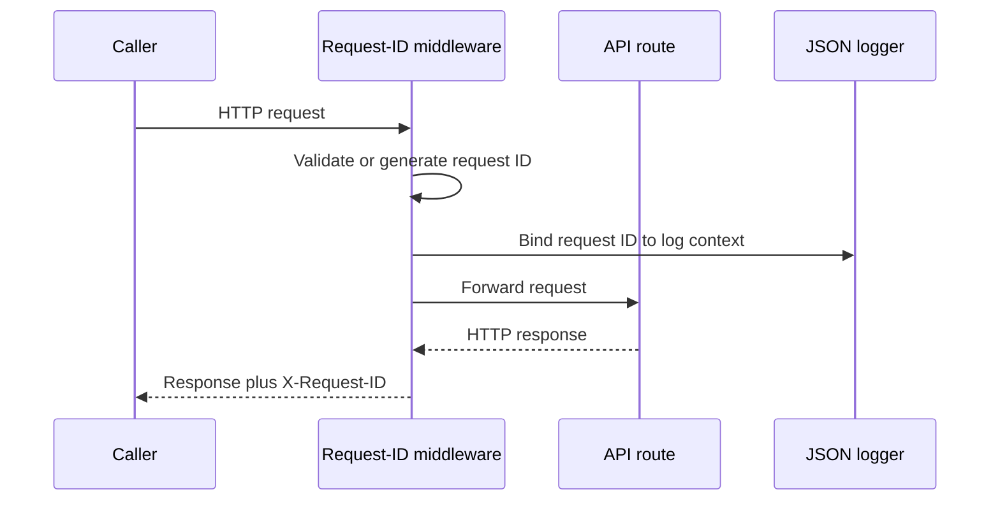
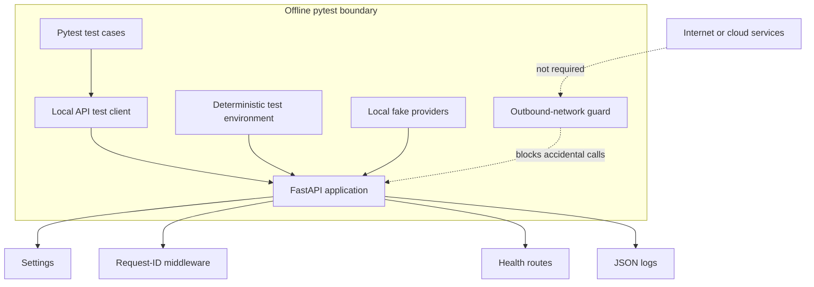
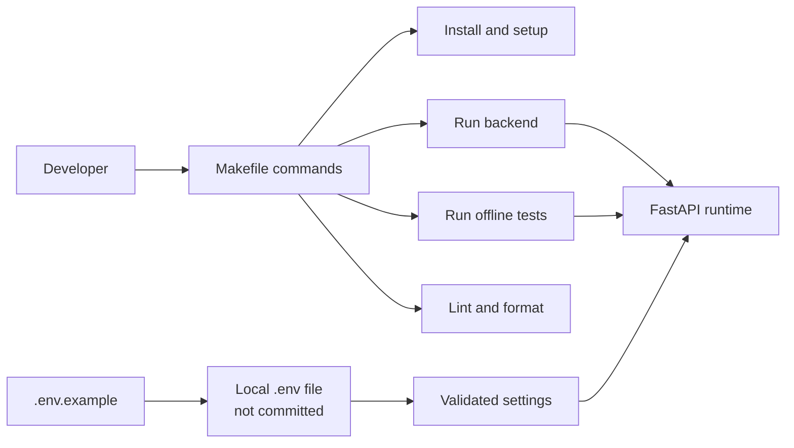
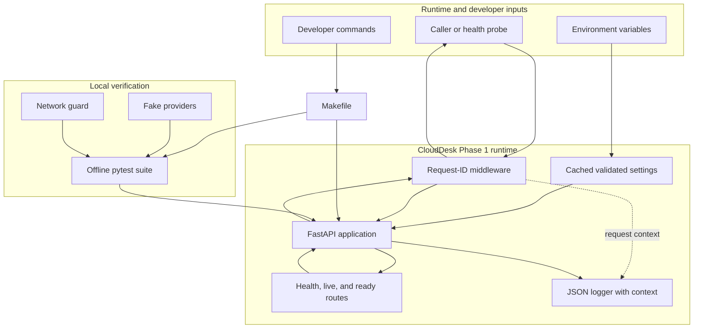

# Phase 1 — Project System Design Evolution

## Purpose and phase boundary

Phase 1 turns CloudDesk from a project idea into a dependable API runtime. It does **not** add customers, tickets, authentication, or workflow automation. Its job is to create a small foundation that later phases can safely extend.

The phase evolved through four subtasks:

1. P1-1 — settings and JSON logging
2. P1-2 — health routes and request-ID middleware
3. P1-3 — offline pytest harness
4. P1-4 — Makefile and `.env.example`

## Beginning of Phase 1 — the simplest design

At the beginning, the application only needed to accept an HTTP request and return a response. There was no shared configuration, operational visibility, or automated safety net.

This is simple, but it leaves important questions unanswered: Which environment is running? How can an operator read the logs? Is the process alive? How can one request be followed across log entries? Can the application be tested without external services?

## P1-1 — Central settings and structured logging

### Design change

The first subtask adds two shared runtime services:

- `core/config.py` reads environment variables into one validated settings object. The object is cached so the application uses one consistent configuration.
- `core/logging.py` emits JSON log records. JSON gives machines and people predictable fields instead of unstructured text.

Request and workflow context can be attached to logs without every caller manually rebuilding the logging format.

### Why the design improved

Configuration is no longer scattered across modules, and log consumers receive stable fields. Later components can depend on the same settings and logging contracts.

## P1-2 — Health routes and request correlation

### Design change

The API now exposes three operational checks:

- `/health` gives a general service status.
- `/health/live` confirms that the process can respond.
- `/health/ready` confirms that the application is ready to receive traffic at this phase.

Request-ID middleware sits around the API. It accepts a safe incoming request ID or creates one, makes it available to logs, and returns it in the response. It also preserves the identifier when an unhandled error becomes an HTTP 500 response.

### Request path

### Why the design improved

Deployment systems can distinguish liveness from readiness, while a support engineer can use one identifier to connect a user-visible failure to its log records.

## P1-3 — Offline automated test boundary

### Design change

The test harness makes the runtime verifiable without cloud credentials or network access. Test configuration is isolated, outbound network activity is blocked, and provider dependencies can be replaced with local fakes.

### Why the design improved

Tests are repeatable on a laptop and in a future CI runner. A passing result cannot secretly depend on a developer's internet connection or private cloud account.

## P1-4 — Consistent developer entry points

### Design change

The final subtask standardizes how people configure and operate the project:

- `.env.example` documents required and optional environment variables without containing secrets.
- The `Makefile` gives memorable commands for setup, running the backend, testing, linting, and formatting.

### Why the design improved

Project knowledge is encoded in version-controlled interfaces instead of depending on personal notes. A new developer has one configuration template and one command surface.

## End of Phase 1 — final runtime architecture

## Key architecture decisions and trade-offs

| Decision | Benefit | Trade-off at this phase |
|---|---|---|
| One settings object | Consistent, validated configuration | Requires cache clearing when tests intentionally change environment values |
| JSON logs | Searchable, machine-readable operational data | Less visually friendly than plain console text without a formatter |
| Request ID at middleware level | Covers every route and most failures | It correlates a request but does not yet identify an authenticated user |
| Separate live and ready endpoints | Supports future orchestration and dependency checks | Readiness is intentionally shallow before databases and services arrive |
| Offline-first tests | Fast, deterministic, credential-free validation | Cannot prove real cloud integration by itself |
| Makefile command surface | Consistent local workflow | Windows users need an environment capable of running `make` |

## Phase 1 exit and handoff

At the end of Phase 1, CloudDesk has an observable and testable runtime skeleton. The design deliberately stops before persistence. Phase 2 can now add database models, schema controls, repositories, and demo data without reinventing configuration, logs, health checks, or test isolation.

The verified boundary is local execution and offline tests. This phase does not claim a deployed service, live PostgreSQL connection, or external monitoring system.
