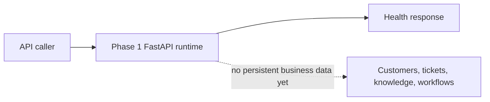
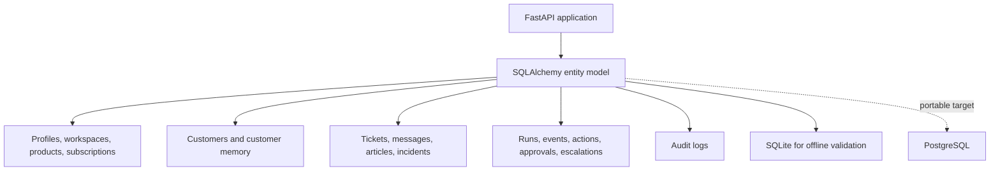
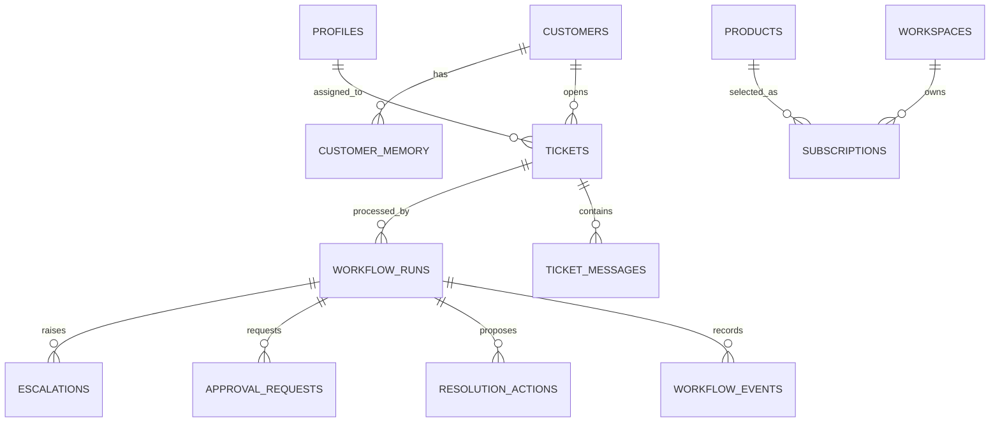
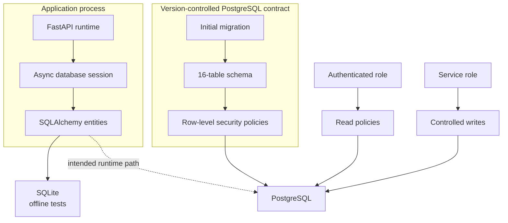
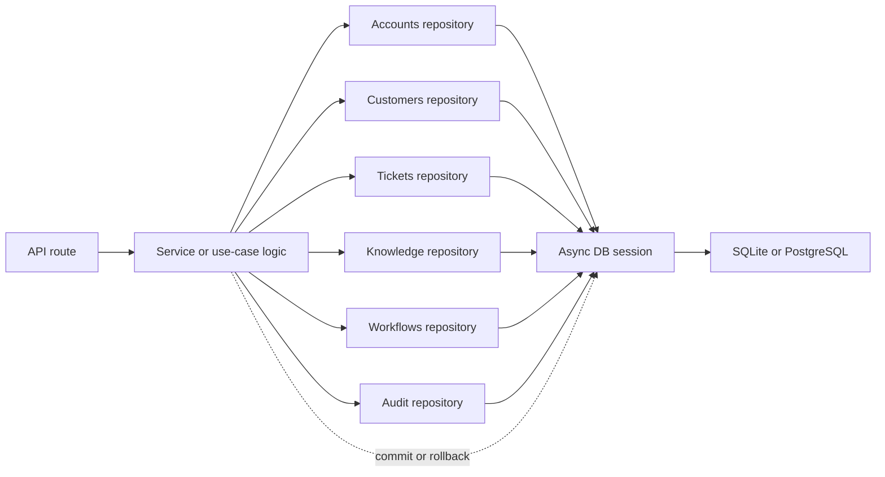
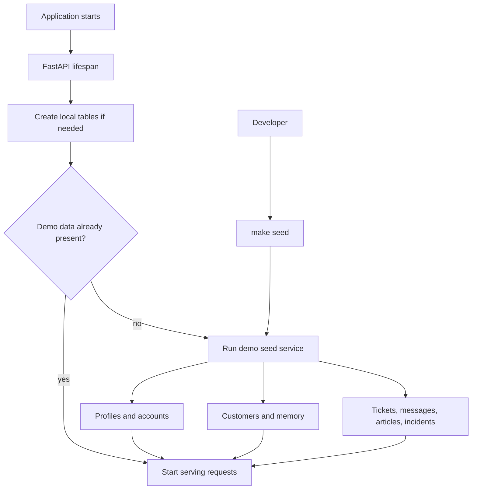
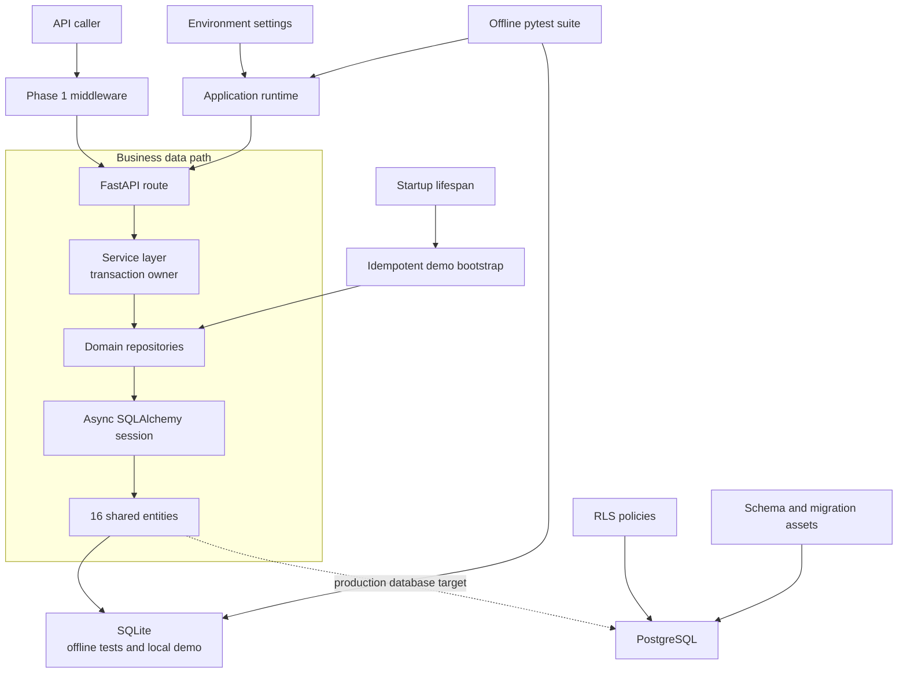
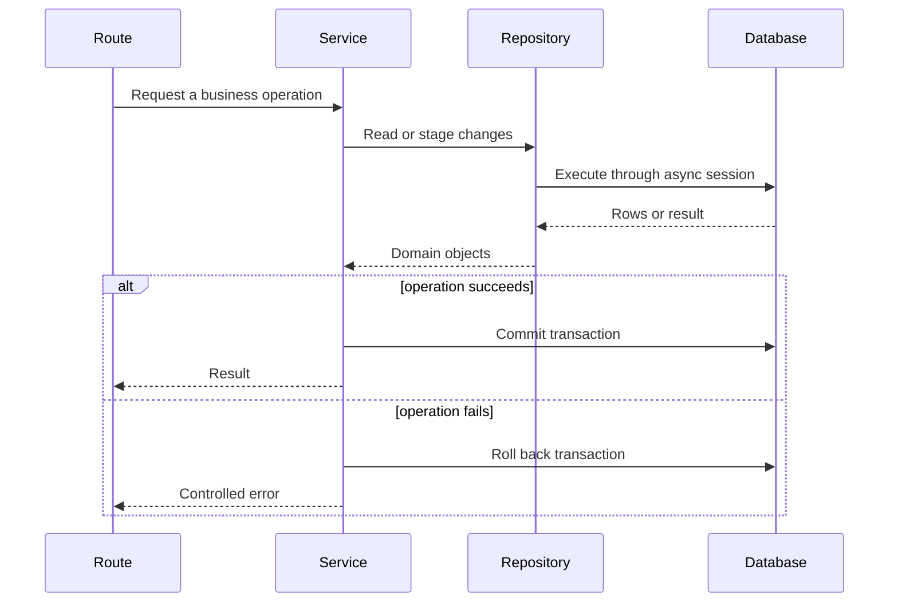

# Phase 2 — Project System Design Evolution

## Purpose and phase boundary

Phase 2 evolves the Phase 1 runtime into a data-backed support platform. It defines what CloudDesk stores, how application code accesses it, how PostgreSQL should protect it, and how a complete local demonstration is created.

The phase evolved through four subtasks:

1. P2-1 — SQLAlchemy entities and category enum
2. P2-2 — PostgreSQL schema, row-level security, and migrations
3. P2-3 — repository layer
4. P2-4 — sample data and demo bootstrap

## Beginning of Phase 2 — runtime without business memory

Phase 2 inherits the settings, logging, middleware, health routes, and tests from Phase 1. The API can run reliably, but it cannot remember a customer or ticket after a request finishes.

## P2-1 — Domain model and portable entities

### Design change

SQLAlchemy entities define the application's shared data language. Sixteen tables cover five related areas:

- accounts: profiles, workspaces, products, subscriptions;
- customers: customers and customer memory;
- support: tickets, ticket messages, support articles, and incidents;
- workflow: workflow runs, workflow events, resolution actions, approval requests, and escalations;
- governance: audit logs.

Portable IDs and JSON fields allow the same model to run with SQLite during offline tests and PostgreSQL in the intended production environment. A category enum gives ticket classification a controlled vocabulary.

### Core relationship view

### Why the design improved

Later features can share one domain model instead of inventing incompatible data shapes. The model records both support data and the future automation trace needed to explain decisions.

## P2-2 — PostgreSQL schema, migration, and data boundary

### Design change

The conceptual model becomes a deployable PostgreSQL design:

- `database/schema.sql` defines the database objects;
- `database/migrations/0001_initial_schema.sql` gives the schema a repeatable starting migration;
- `database/rls_policies.sql` enables row-level security on every application table;
- authenticated access is read-oriented, while service-role code owns mutations.

The application also gains an asynchronous database engine and session factory. SQLite remains the local test database; `asyncpg` is the PostgreSQL path.

### Why the design improved

Schema creation is reproducible, access rules live beside the code, and application I/O is asynchronous. Row-level security provides a database-side guard rather than relying only on route code.

## P2-3 — Repository layer separates storage from behavior

### Design change

Repositories become the only normal path through which services query and change domain data. They are grouped by responsibility: accounts, customers, tickets, knowledge, workflows, and audit.

Repositories perform data operations but do not decide when a business operation should be committed. The service layer owns transaction boundaries, including commit and rollback.

### Why the design improved

Routes do not need to know SQL details, repository queries can be tested independently, and one service can coordinate several repositories within one transaction.

## P2-4 — Repeatable demo world and startup lifecycle

### Design change

The final subtask creates a useful local system rather than an empty schema. Demo bootstrap data includes three user profiles, eight customers, thirteen tickets, fifteen knowledge articles, four memory records, and the supporting products, workspaces, subscriptions, messages, and incidents.

At application startup, the lifespan handler creates local tables and seeds demo data only when the configured demo database is empty. The operation is idempotent, so restarting the application does not multiply the sample records. A `make seed` command and SQL seed asset provide explicit setup paths.

### Why the design improved

Every developer can start from the same meaningful scenario. Idempotency makes startup predictable, and the seed layer uses the same application abstractions instead of becoming a separate data model.

## End of Phase 2 — final persistence architecture

## Data operation sequence

## Key architecture decisions and trade-offs

| Decision | Benefit | Trade-off at this phase |
|---|---|---|
| One ORM model for SQLite and PostgreSQL | Fast offline tests with a realistic production path | SQLite cannot reproduce every PostgreSQL behavior |
| Sixteen normalized entities | Clear ownership and traceable workflow history | More relationships and migrations to maintain |
| Database row-level security | Defense in depth for stored data | Policies still need live PostgreSQL integration testing |
| Repositories grouped by domain | Keeps SQL away from routes and services | Adds an abstraction layer to simple queries |
| Services own transactions | Multi-repository work can be atomic | Service authors must handle commit and rollback correctly |
| Idempotent demo bootstrap | Reliable, useful local startup | Demo data is not a production provisioning strategy |

## Phase 2 exit and handoff

At the end of Phase 2, CloudDesk has a coherent persistence layer and a repeatable demonstration dataset. Phase 3 can authenticate a user against these profiles, limit requests, and record mutations in the audit table.

The entity and repository behavior is verified locally with SQLite, and the PostgreSQL SQL assets are structurally tested. This phase does **not** claim that a live PostgreSQL or Supabase environment has been exercised.
