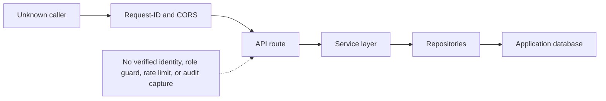
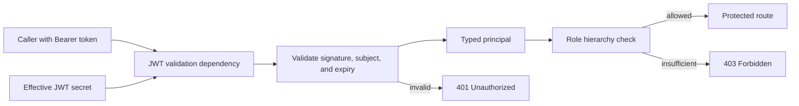
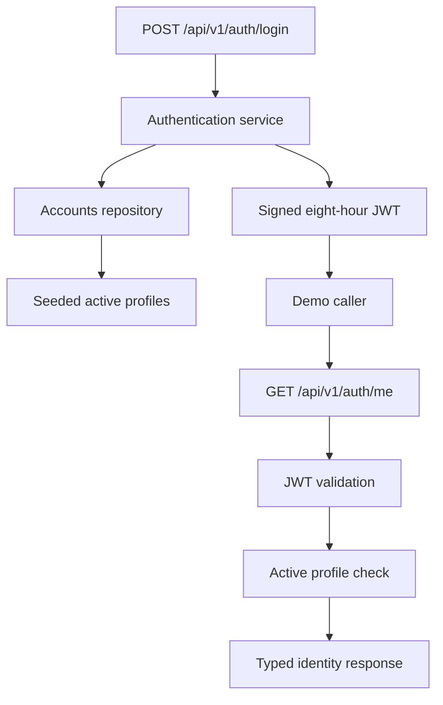
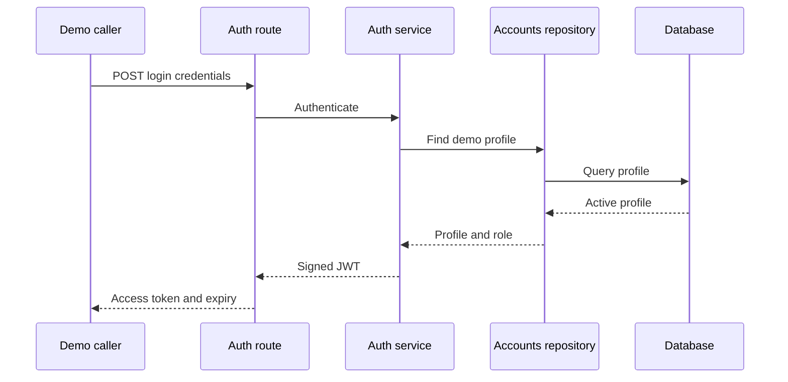
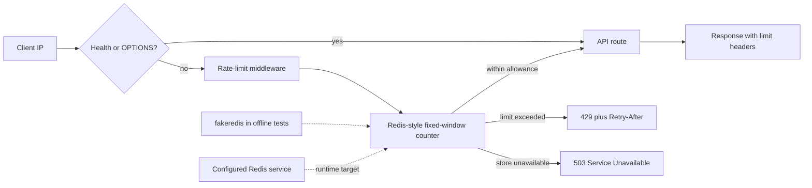
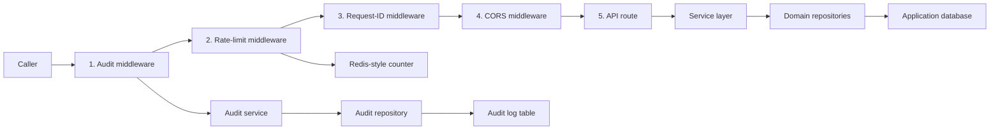
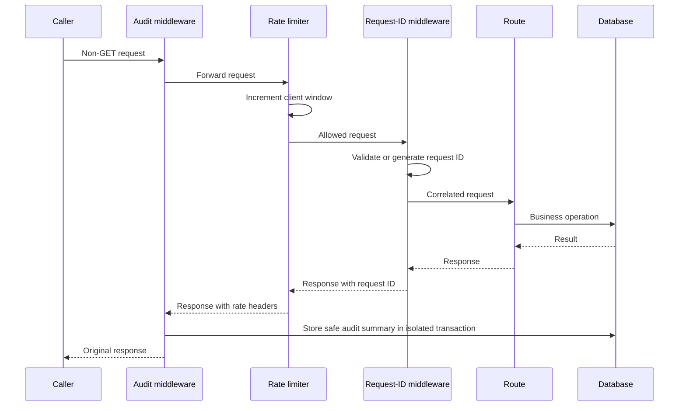
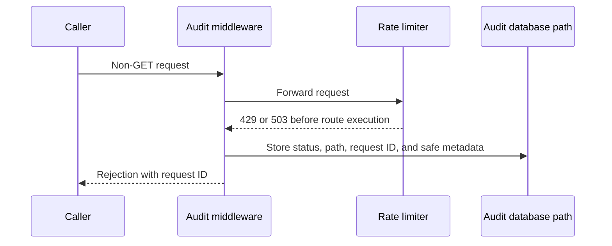
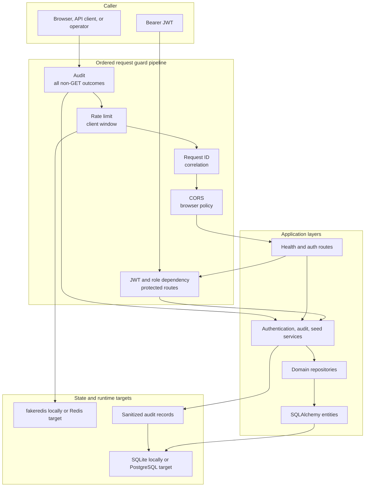

# Phase 3 — Project System Design Evolution

## Purpose and phase boundary

Phase 3 adds identity and request guards around the data-backed application. It answers four operational questions: Who is calling? What are they allowed to do? Are they sending too many requests? Can important changes be traced without recording secrets?

The phase evolved through four subtasks:

1. P3-1 — JWT validation and `require_role`
2. P3-2 — demo authentication routes and tokens
3. P3-3 — Redis-backed rate limiting
4. P3-4 — audit middleware and final middleware order

## Beginning of Phase 3 — data without request identity

Phase 3 inherits the runtime and persistence architecture. Profiles and tickets exist, but an incoming request is not yet connected to a verified principal and no shared guard controls request volume.

## P3-1 — JWT identity and role-based authorization

### Design change

The security module validates HS256 JSON Web Tokens and builds a typed principal. Tokens must contain a subject and expiry. The application can read a role from supported Supabase-compatible claim locations, then apply a hierarchy of `viewer < agent < admin`.

`require_role` is a reusable route dependency:

- missing, malformed, expired, or invalid credentials produce HTTP 401;
- a valid identity with insufficient authority produces HTTP 403.

The effective secret follows the configured Supabase secret precedence, allowing future Supabase-issued tokens while supporting the local demo.

### Why the design improved

Authentication and authorization rules are centralized and testable. Route handlers receive a known principal instead of manually parsing headers and claims.

## P3-2 — Demo login and identity inspection

### Design change

Two routes make the identity system usable in a local demonstration:

- `POST /api/v1/auth/login` validates one of the seeded demo profiles and returns an eight-hour access token.
- `GET /api/v1/auth/me` validates the token and returns the active database profile.

The auth service separates credential and profile rules from HTTP details. A token is not sufficient by itself: `/me` also confirms that the corresponding profile remains active.

### Login sequence

### Why the design improved

The complete authentication loop can be shown offline with the same profiles used by the persistence layer. The route, service, repository, and token responsibilities remain separate.

## P3-3 — Shared rate limiting through Redis semantics

### Design change

Rate-limit middleware counts requests per client IP in fixed 60-second windows. The default allowance is 120 requests per minute. It returns limit headers on responses and uses HTTP 429 with `Retry-After` when the allowance is exhausted.

Health checks and CORS preflight requests are exempt. Redis failure returns HTTP 503 instead of silently disabling the guard. Offline tests use `fakeredis`; the configured Redis URL is the intended shared runtime path.

### Why the design improved

One guard applies consistently across routes and can share counters across multiple application processes when connected to Redis. Failure behavior is explicit rather than insecurely failing open.

## P3-4 — Audit capture and deliberate middleware order

### Design change

Audit middleware observes every non-GET request, including requests rejected by inner guards. It records operational metadata such as method, path, status, request ID, actor when safely available, client IP, and user agent.

It deliberately does **not** store request bodies, query strings, passwords, tokens, or authorization headers. Audit writes use an isolated transaction, and an audit-storage failure never changes the response already owed to the caller.

Middleware is registered as `CORS → RequestId → RateLimit → Audit`. Starlette wraps later registrations around earlier ones, so incoming requests traverse the stack in this order:

`Audit → RateLimit → RequestId → CORS → route`

Responses travel back in reverse. For an early 429 or 503 produced before Request-ID middleware runs, the outer layers still ensure an identifier is available for the audit record and response.

### Mutation request sequence

### Rejected request sequence

### Why the design improved

Security controls now compose as one request pipeline. The audit layer can see successful and rejected mutations, the rate limiter protects the inner application, and request correlation remains available across failures.

## End of Phase 3 — final guarded application architecture

## Key architecture decisions and trade-offs

| Decision | Benefit | Trade-off at this phase |
|---|---|---|
| HS256 JWT with Supabase-compatible claims | Local demo and future provider alignment share one principal model | Shared-secret rotation and live Supabase verification remain operational work |
| Explicit role hierarchy | Reusable, predictable authorization | Coarse roles do not yet express resource-level permissions |
| Active profile check | Disabled users cannot rely on an unexpired token | Protected profile lookups add database work |
| Redis-style fixed windows | Simple, fast, and shareable across processes | Fixed windows can allow bursts near a boundary |
| Fail closed when the rate store fails | Protection is never silently removed | Redis disruption can temporarily reject normal traffic |
| Metadata-only audit records | Useful accountability without copying secrets | The audit trail intentionally cannot reconstruct full request content |
| Audit failures do not replace user responses | Observability problems do not corrupt business behavior | Operators need monitoring to notice audit-write failures |

## Phase 3 exit and handoff

At the end of Phase 3, CloudDesk has a locally testable identity and request-protection boundary. Future business routes can reuse the JWT principal, role dependency, rate guard, request correlation, repository layer, and audit capture instead of designing security separately for each feature.

The integrated offline suite verifies these contracts with SQLite and `fakeredis`. The production paths for live Supabase tokens, PostgreSQL, and Redis are designed but are not claimed as deployed or live-tested in this phase.
