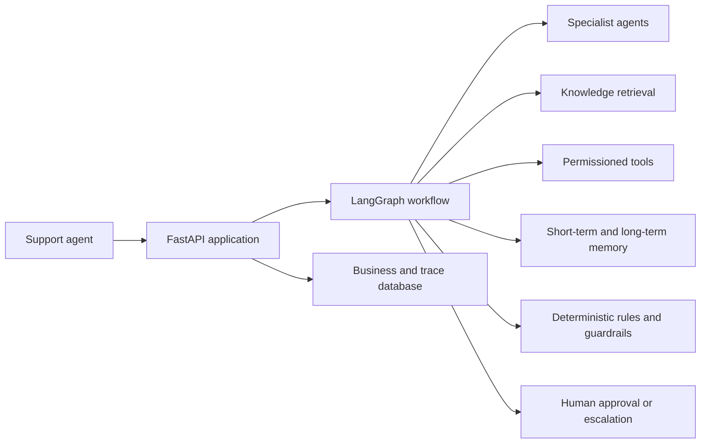
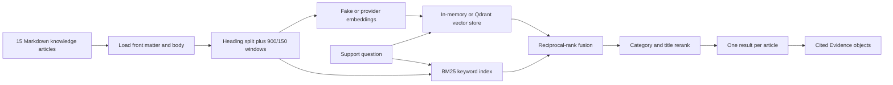
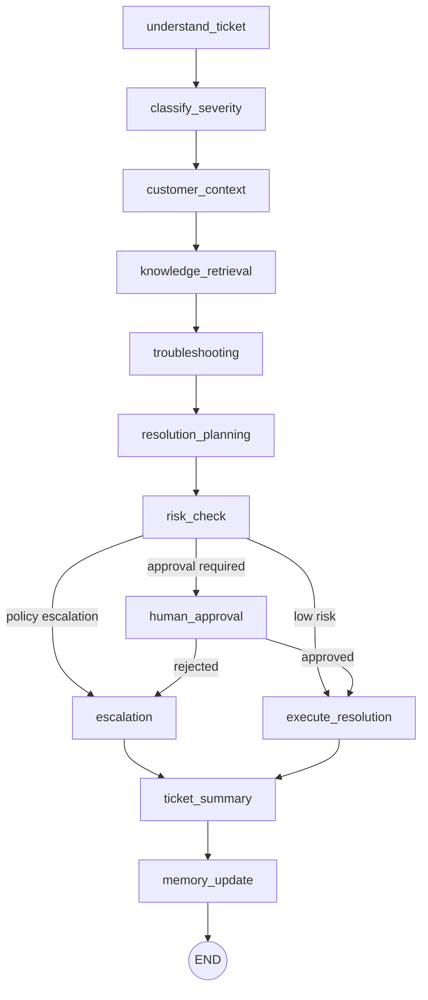
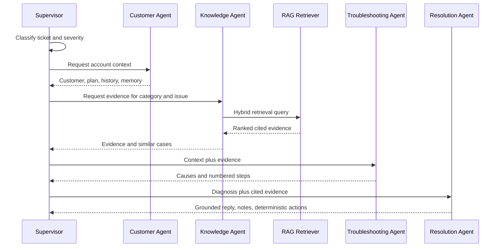

# CloudDesk Knowledge Transfer: RAG, Agentic Workflows, and Multiple Agents

## 1. Why this guide exists

This document is a practical learning path for understanding the RAG and agentic architecture being built in CloudDesk. Use it alongside the code—not as a replacement for reading the code and running tests.

It explains:

- how retrieval-augmented generation (RAG) will work in this project;
- why CloudDesk uses several specialist agents instead of one large prompt;
- how deterministic rules, tools, memory, and human approval make the system safe;
- how LangGraph coordinates the complete workflow;
- which files to read and which experiments to run after every implementation task;
- how to explain the design in an interview.

## 2. Honest starting point

As of 29 October 2026, Phases 1–4 are implemented and validated locally. They provide the runtime, persistence, authentication, request guards, and ticket/customer APIs.

The following learning surfaces are **planned but not implemented yet**:

| Area | TASKS.md phase | Planned location |
|---|---:|---|
| Knowledge ingestion and RAG | Phase 5 | `rag/` and knowledge API files |
| Tool registry and mock integrations | Phase 6 | `backend/app/tools/`, `integrations/` |
| Rules and safety guardrails | Phase 7 | `agents/rules.py`, `agents/prompts.py`, `backend/app/core/guardrails.py` |
| Short-term and long-term memory | Phase 8 | `memory/` |
| Specialist agents and fake LLM | Phase 9 | `agents/specialists/`, `backend/app/core/llm.py` |
| LangGraph workflow and tracing | Phase 10 | `agents/graph.py`, `agents/nodes/`, workflow services |
| Human approval and escalation | Phase 11 | approval services, graph interrupts, action execution |

Do not interpret the design in this guide as proof that these modules already run. Use `TASKS.md`, `PLAN_PHASE.md`, and `MEMORY.md` for the current implementation status.

## 3. The big picture

CloudDesk is not “an LLM with an API.” It is a normal support application with an agentic workflow inside it.



The main idea is separation of responsibility:

- RAG supplies evidence.
- Agents perform narrowly defined reasoning tasks.
- Rules make decisions that must never depend only on model probability.
- Tools perform reads and side effects through one controlled gateway.
- The graph determines execution order and branching.
- Memory carries useful context across steps or future tickets.
- A human approves consequential actions.
- The trace explains what happened.

## 4. Three ideas that must not be confused

### 4.1 RAG

RAG retrieves relevant external knowledge and gives it to an agent before the agent answers. It does not train or fine-tune the model.

In CloudDesk, RAG answers questions such as:

- Which knowledge article explains MFA recovery?
- What policy applies to API rate limits?
- Which previously resolved cases look similar?
- What evidence can be cited in a proposed customer reply?

### 4.2 An agent

An agent is a component that receives structured state, performs a bounded responsibility, and returns structured output. It may use a model, deterministic rules, retrieval, or tools.

An agent is not required to call an LLM. For example, the planned Customer Agent loads database context and should not need a model call.

### 4.3 An agentic workflow

The workflow is the state machine that coordinates agents and decides what happens next. LangGraph supplies graph execution, state updates, persistence, branching, interruption, and resume behavior.

The workflow—not an individual agent—owns the end-to-end ticket journey.

## 5. Learn the implemented foundation first

Before Phase 5, understand the layers that RAG and agents will depend on.

Read these files in order:

1. `CLAUDE.md` — product rules and final architecture.
2. `TASKS.md` — implementation order.
3. `PLAN_PHASE.md` — phase exit criteria.
4. `backend/app/models/entities.py` — tickets, knowledge articles, workflow runs, events, actions, approvals, escalations, and memory tables.
5. `backend/app/repositories/` — the only normal SQL access path.
6. `backend/app/services/` — orchestration and transaction ownership.
7. `backend/app/api/tickets.py` and `customers.py` — current HTTP entry points.
8. `tests/conftest.py` — how the project guarantees offline testing.

The key dependency rule is:

```text
API → services → repositories → database
                ↘ future graph / RAG / tools / memory
```

Agents must not write SQL directly, and RAG must not know about tickets.

## 6. RAG in CloudDesk

## 6.1 Planned RAG pipeline



The source pipeline will be:

```text
sample_data/knowledge_base/*.md
    → load_article_files()
    → chunk_article()
    → embeddings and indexes
    → retrieve()
    → Evidence[]
```

## 6.2 Source documents

Each article uses YAML front matter for fields such as:

- title;
- category;
- tags;
- summary.

The Markdown body contains headings and support guidance. These articles are the allowed source for customer-facing policy claims. A model should not invent a policy from its pretrained memory.

When P5-1 lands, inspect several files under `sample_data/knowledge_base/` and answer:

1. Which metadata is used for filtering?
2. Which text becomes searchable?
3. How is the article identity preserved after chunking?
4. Which part becomes a citation source?

## 6.3 Chunking

CloudDesk uses two-stage chunking:

1. Split on Markdown headings so sections retain semantic meaning.
2. Split large sections into approximately 900-character windows with 150-character overlap.

Every chunk is prefixed with:

```text
{article title} - {section heading}
```

Why this matters:

- A small paragraph may not contain enough context by itself.
- The title and heading improve both keyword and semantic retrieval.
- Overlap prevents an important sentence pair from being separated at a window boundary.
- Article and section metadata make citations traceable.

Study exercise after P5-1:

1. Pick one article.
2. Run its chunking test with `-vv`.
3. Print or inspect the generated chunks.
4. Confirm that no chunk exceeds the expected size by an unreasonable amount.
5. Find text repeated because of the overlap and explain why that is helpful.

## 6.4 Embeddings

An embedding converts text into a numeric vector. Similar meanings should produce vectors that are close under the selected similarity function.

CloudDesk plans two paths behind the same interface:

- `FakeEmbeddings`: a deterministic, hashed bag-of-words vector with 384 dimensions for offline tests;
- a configured provider embedding model for an external environment.

The fake implementation is valuable because it proves orchestration, indexing, filtering, and ranking without an API key. It does **not** prove the semantic quality of a production embedding model.

Questions to answer after P5-2:

- Is the same input always mapped to the same vector?
- Is the vector always 384 dimensions in fake mode?
- Where is the provider selected?
- Does any retriever code know whether Qdrant or memory storage is active?
- What happens when the embedding model changes?

The expected answer to the final question is: reindex the collection, because old and new vectors are not safely comparable.

## 6.5 Vector store abstraction

The planned `VectorStoreService` protocol exposes operations such as:

```text
add_documents · search · delete · count · health
```

Implementations:

- `InMemoryVectorStore` for offline development and tests;
- `QdrantVectorStore` for the external vector-database path.

The retriever depends on the protocol, not a concrete store. This is dependency inversion: business retrieval behavior remains stable when infrastructure changes.

## 6.6 Keyword retrieval with BM25

Vector similarity is useful for meaning, but exact terms are often critical in support:

- error codes;
- product names;
- “HTTP 429”;
- “MFA”;
- plan or feature names.

BM25 ranks documents using term frequency, inverse document frequency, and document-length normalization. It is usually strong when the query and article share important exact terms.

## 6.7 Hybrid retrieval

CloudDesk combines semantic and keyword rankings instead of trusting one method.

Implemented flow:

```text
semantic results ∪ keyword results
    → reciprocal-rank fusion (RRF, k=60)
    → heuristic rerank
    → optional LLM rerank
    → one hit per article
```

A simplified RRF score is:

```text
score(document) = Σ 1 / (60 + rank_in_each_result_list)
```

RRF uses rank positions rather than trying to directly compare incompatible vector and BM25 scores.

The heuristic reranker then rewards signals such as:

- the article category matching the ticket category;
- query words appearing in the article title.

Finally, one hit per article prevents several neighboring chunks from the same article from crowding out other useful evidence.

## 6.8 Retrieval modes

The retriever supports:

- `semantic` — vector search only;
- `keyword` — BM25 only;
- `hybrid` — both, fused and reranked.

Use all three modes when learning. Do not only test that hybrid returns something. Compare why each mode ranks the same article differently.

## 6.9 Evidence contract

Retrieved items become structured evidence rather than loose text:

```json
{
  "id": "chunk-id",
  "title": "MFA Recovery",
  "source": "kb://mfa-recovery#administrator-assisted-recovery",
  "snippet": "Relevant article text...",
  "score": 0.87,
  "url": "/knowledge/article-id",
  "article_id": "article-id"
}
```

This shape is important because the system can show what was retrieved, how strongly it ranked, and where it came from. Evidence supports explainability; it is not hidden model reasoning.

## 6.10 Retrieval caching

Retrieval results use an optional short Redis/fakeredis cache with a key shaped like:

```text
rag:{mode}:{category}:{top_k}:{query}
```

The planned TTL is 300 seconds. Include every result-changing parameter in the key. Otherwise, a semantic request could incorrectly receive a cached keyword result.

## 6.11 RAG evaluation

The primary planned metric is hit-rate@3:

```text
hit-rate@3 = queries whose expected article appears in top 3 / total evaluation queries
```

The project threshold is at least 0.75.

The important lesson is that a retrieval system must be measured independently from final answer quality. A model cannot cite the correct article if retrieval never supplies it.

## 6.12 Follow one RAG example

Use ticket `CD-1012`: “Locked out after MFA attempts.”

After Phase 5 is complete, trace it like this:

1. Read the ticket from `sample_data/tickets.json`.
2. Identify the expected MFA recovery article.
3. Inspect how that article is chunked.
4. Search using `keyword`, `semantic`, and `hybrid` modes.
5. Compare top-three results and scores.
6. Confirm that hybrid returns the expected article in the top three.
7. Verify the `source` points to the correct article and section.
8. Confirm the result can be rendered as an `Evidence` object.

## 7. Multiple specialist agents in CloudDesk

CloudDesk uses specialists because support resolution contains different kinds of work. One giant prompt would mix classification, account lookup, retrieval, troubleshooting, policy, and action planning.

| Specialist | Responsibility | Model required? | Important boundary |
|---|---|---:|---|
| Support Supervisor | Understand, classify, assess severity, summarize | Usually | Rules may override or raise decisions |
| Customer Agent | Load customer, subscription, workspace, history, memory | No | Reads through tools/repositories, not SQL in agent code |
| Knowledge Agent | Retrieve evidence and similar cases | Sometimes | Returns citations, not unsupported policy |
| Troubleshooting Agent | Produce causes and numbered steps | Usually | Enriched by deterministic playbooks and service status |
| Resolution Agent | Propose reply, notes, and actions | Usually | Actions come from deterministic planning |
| Escalation Agent | Decide and route escalation | Sometimes | Policy rules always win |

This is not six independent bots chatting freely. They are bounded components coordinated by one graph and one shared typed state.

## 8. The rules-plus-LLM design

CloudDesk deliberately separates two decision types.

### Deterministic policy decisions

Rules decide cases where inconsistency is unacceptable:

- payment disputes;
- deletion and GDPR requests;
- security incidents;
- data loss;
- legal issues;
- enterprise outages.

### Model judgment

The model helps where interpretation is useful:

- summarizing unclear customer language;
- classifying grey-area issues;
- suggesting probable causes;

- drafting a grounded response.

The pattern is:

```python
matched_rules = matching_escalation_rules(ticket_text, plan)
model_result = await call_structured(EscalationDecision, ...)

if matched_rules:
    decision = policy_decision
else:
    decision = constrained_model_result
```

For severity, rules may raise a model result but never lower it.

Interview explanation: “We use the LLM for judgment, not authority. Deterministic rules own high-impact policy decisions.”

## 9. Structured outputs

Each specialist returns a Pydantic model, not free-form prose. Planned schemas include concepts such as:

- `Classification`;
- `SeverityAssessment`;
- `CustomerContext`;
- `Evidence` and `PreviousCase`;
- `Diagnosis`;
- `ResolutionPlan`;
- `EscalationDecision`.

Structured outputs provide:

- validation;
- predictable graph state;
- safer UI rendering;
- testable fields;
- controlled retries or failures when model output is invalid.

When Phase 9 lands, read `backend/app/schemas/workflow.py` before reading prompts. The schemas tell you what each agent is allowed to produce.

## 10. Tools are capabilities, not ordinary helper functions

Planned tools include:

| Tool | Reads or writes? | Approval required? |
|---|---|---:|
| `get_customer` | read | no |
| `get_subscription` | read | no |
| `get_ticket_history` | read | no |
| `search_docs` | read | no |
| `check_service_status` | read | no |
| `update_ticket` | write | no under current policy |
| `reset_demo_setting` | write | yes |
| `create_refund_request` | write | yes |
| `create_escalation` | safe routing write | no |

Every tool execution must pass through `ToolRegistry.execute(...)`.

The registry supplies:

- allow-listing;
- approval checks;
- timeout handling;
- uniform success/failure results;
- a single traceable execution path.

Unknown tools require approval. Tool exceptions become failure results instead of crashing the entire workflow.

## 11. Planned actions must be deterministic

The model may help write a resolution, but it must not invent executable tool calls.

The expected pattern is:

```text
model proposes explanation and intent
    → deterministic ResolutionAgent.plan_actions(...)
    → PlannedAction objects
    → policy marks approval requirement
    → ToolRegistry executes only allowed actions
```

This prevents prompt injection or model hallucination from turning arbitrary text into a side effect.

## 12. LangGraph orchestration

## 12.1 Planned graph



## 12.2 Shared state

The graph state will contain items such as:

- ticket and customer identifiers;
- classification and severity;
- customer context;
- evidence and previous cases;
- diagnosis;
- resolution plan;
- risk and escalation decisions;
- approval status;
- token usage, completed nodes, and errors.

Each node returns a **partial state update**. It should not return or overwrite the complete state.

Reducer fields have special behavior:

- `completed_nodes` appends;
- `errors` appends;
- `token_usage` merges and sums.

If a node replaces these fields rather than returning the correct partial update, previous history disappears.

## 12.3 Node anatomy

The planned node pattern is:

```python
async def troubleshooting(state):
    tracer = tracer_for(state)
    async with tracer.node("troubleshooting"):
        diagnosis, usage = await TroubleshootingAgent().run(...)
        await record_llm(...)
    return {
        "diagnosis": diagnosis,
        "token_usage": usage,
        "completed_nodes": ["troubleshooting"],
        "current_node": "troubleshooting",
    }
```

Read a node in this order:

1. Which state fields does it read?
2. Which specialist or service does it call?
3. Which events does it trace?
4. Which partial fields does it return?
5. Which graph edge consumes its result?

## 12.4 Conditional routing

`risk_check` selects among three paths:

- escalate when a policy rule demands it;
- pause for approval when an action is consequential;
- execute automatically when risk is low.

Risk becomes high when, for example:

- an action requires approval;
- a policy escalation matched;
- severity is critical;
- prompt injection was detected;
- customer-output validation failed.

## 12.5 Checkpointing

Graph state is checkpointed so a workflow can pause and resume.

- Tests use `InMemorySaver` when `CHECKPOINT_DB_PATH=:memory:`.
- A local file path uses `AsyncSqliteSaver`.

The business trace also lives in normal tables such as `workflow_runs` and `workflow_events`. A checkpointer resumes execution; the business tables support application views and auditability. These are related but not identical responsibilities.

## 13. Human approval and graph interrupts

When an action needs approval:

1. The graph reaches `human_approval`.
2. An `approval_request` is recorded.
3. The ticket becomes `waiting_on_approval`.
4. LangGraph calls `interrupt()`.
5. The API returns current state while the graph is paused.
6. A support agent approves or rejects.
7. The graph resumes with `Command(resume=decision)`.
8. Approval executes the controlled action; rejection routes to escalation.

Important LangGraph behavior: code before `interrupt()` runs again after resume. Keep that code minimal and idempotent. Otherwise, an approval row or notification could be created twice.

Study `CD-1002` for this path. It requests a refund and must never become a zero-touch financial action.

## 14. Escalation is a safe outcome

Escalation is not a workflow failure. It is the correct resolution when automation should stop.

Use these demo cases:

- `CD-1005` — security incident;
- `CD-1006` — data loss;
- `CD-1009` — deletion/GDPR;
- `CD-1011` — payment dispute.

For each case, identify:

1. the matching deterministic rule;
2. the named destination team;
3. why model confidence must not override the rule;
4. the graph edge that routes to escalation.

## 15. Memory is not RAG

RAG retrieves shared knowledge articles. Memory stores customer- or workflow-specific context.

| Concern | RAG | Memory |
|---|---|---|
| Main source | Knowledge base | Ticket/customer interactions |
| Scope | Shared support knowledge | Ticket or customer context |
| Typical question | “Which policy explains this?” | “What happened for this customer before?” |
| Storage | Vector store plus keyword index | Redis/fakeredis and SQL |
| Retention | Until reindex/deletion | TTL for short-term; durable for long-term |

Planned memory tiers:

- short-term Redis/fakeredis memory: conversation, workflow state, retrieval cache; 24-hour TTL;
- long-term `customer_memory`: preferences, past issues, troubleshooting, and notes; durable and deduplicated.

Durable memory must never contain:

- card numbers;
- API keys;
- passwords;
- raw ticket bodies;
- data belonging to another customer.

Every durable note passes through `scrub()`. Exact duplicates are skipped.

## 16. How RAG enters the multi-agent workflow



Notice that RAG does not directly send a customer reply. It provides evidence to specialists that diagnose and plan a resolution.

## 17. Guardrails around untrusted content

Customer ticket text is data, not instruction.

The planned defense has several layers:

1. `scan_for_injection` flags suspicious patterns.
2. `wrap_untrusted` places customer content inside explicit untrusted delimiters.
3. `SECURITY_PREAMBLE` instructs models not to follow content inside those delimiters.
4. Deterministic planning prevents text from directly inventing tool calls.
5. Tool policy blocks unauthorized execution.
6. `validate_customer_output` blocks secrets, internal URLs, and other customers’ data.
7. High-risk or invalid output routes to approval or escalation.

Use `CD-1013` as the safety test. The text asks the system to ignore instructions and export records. The correct result is to analyze it as a security ticket, never execute the embedded request.

## 18. Observability and explainability

The future `WorkflowTracer` records:

- node start and completion;
- tool calls and results;
- model calls with timing, token usage, and estimated cost;
- approval requests and decisions;
- errors;
- workflow completion.

It must not expose:

- hidden chain-of-thought;
- raw prompts;
- secrets;
- another customer’s data.

Explainability here means exposing evidence, structured decisions, rules, actions, results, timing, and errors—not private reasoning tokens.

## 19. Best learning order by task

Follow `TASKS.md` rather than jumping directly to `agents/graph.py`.

### Phase 5 — learn RAG as an independent subsystem

1. P5-1: inspect article parsing and chunk boundaries.
2. P5-2: compare fake embeddings, memory vector storage, and the vector-store protocol.
3. P5-3: trace semantic, keyword, hybrid, RRF, reranking, deduplication, and cache behavior.
4. P5-4: run ingestion and call the knowledge API.

Goal: prove that relevant evidence is retrieved before involving an agent.

### Phase 6 — learn controlled capabilities

1. Read tool policy before tool implementations.
2. Trace one read-only tool through the registry.
3. Trace one approval-required tool without approval and confirm it does not execute.
4. Inspect mock integrations and their protocols.

Goal: understand how the system safely acts on the world.

### Phase 7 — learn deterministic safety

1. Run escalation and severity rule tests.
2. Trace prompt-injection wrapping with `CD-1013`.
3. Run output-validation tests.
4. Run secret-scrubbing tests.

Goal: understand which decisions never belong solely to the model.

### Phase 8 — learn memory

1. Compare short-term and long-term interfaces.
2. Observe TTL behavior with fakeredis.
3. Record the same durable note twice and confirm deduplication.
4. Try a note containing a fake key or password and confirm scrubbing.

Goal: distinguish reusable customer context from shared RAG knowledge.

### Phase 9 — learn each specialist separately

Run one specialist at a time with the fake provider. Read its output schema, rules, prompt, tools, and test before moving to the next specialist.

Goal: understand each bounded responsibility without graph complexity.

### Phase 10 — learn orchestration

1. Read state and reducers.
2. Read nodes in graph order.
3. Inspect edges and conditional branches.
4. Run a complete fake-provider workflow.
5. Inspect persisted state and events after every node.

Goal: understand how correct local components become one resumable state machine.

### Phase 11 — learn human-in-the-loop execution

1. Run `CD-1002` until it pauses.
2. Inspect the approval row and checkpoint.
3. Approve and observe resume and action execution.
4. Repeat with rejection and observe escalation.
5. Run `CD-1005` and confirm rules escalate without needing approval.

Goal: understand safe side effects, interrupts, and resumption.

## 20. A repeatable study routine for every subtask

Use this routine after each RAG or agentic task is implemented:

1. Read the task row and phase exit criteria.
2. Read the output schema or protocol first.
3. Read the implementation from entry point to dependency.
4. Read the focused tests before running them.
5. Run one focused test with verbose output.
6. Change one safe input and predict the result before running it.
7. Inspect persisted data or structured output.
8. Explain the component without using framework jargon.
9. Explain one failure mode and its protection.
10. Check `MEMORY.md` for the honest validated boundary.

## 21. Commands to use as phases land

Some commands below will only work after their corresponding task creates the files or Make targets.

```powershell
# Complete offline test suite
uv run pytest -q

# RAG-focused tests after Phase 5 begins
uv run pytest tests/rag -vv

# Agent tests after Phase 9 begins
uv run pytest tests/agents -vv

# Workflow tests after Phase 10 begins
uv run pytest tests/workflow -vv

# Ingestion after P5-4 adds the command
make ingest

# Code-quality check
uv run ruff check backend tests main.py
```

The test harness blocks outbound network calls and selects fake/local providers. A passing offline test should not require a model API key, Qdrant Cloud, live Redis, or Supabase.

## 22. High-value experiments

### RAG experiments

- Remove title prefixes from chunks and compare hit-rate@3.
- Change overlap from 150 to zero and inspect boundary failures.
- Compare `semantic`, `keyword`, and `hybrid` for “HTTP 429”.
- Disable category reranking and compare results.
- Allow multiple chunks per article and observe result crowding.
- Change the embedding model without reindexing and explain why results become invalid.

### Agent experiments

- Give the supervisor an ambiguous issue and inspect structured classification.
- Force a model to suggest lower severity than a deterministic rule and confirm the rule wins.
- Run the Customer Agent and prove it makes no model call.
- Return malformed model output and observe structured-validation behavior.
- Trigger a tool exception and confirm the graph receives a failure result instead of crashing.

### Workflow experiments

- Run a low-risk ticket and record completed-node order.
- Run `CD-1002` and inspect pause/resume state.
- Reject `CD-1002` and confirm escalation routing.
- Run `CD-1005` and confirm policy escalation.
- Run `CD-1013` and prove its embedded instruction does not alter graph routing.

Only perform experiments on a disposable local database or in tests.

## 23. Common misconceptions

### “RAG makes the model know the database”

No. RAG retrieves selected text and supplies it as context for one request.

### “Vector search replaces keyword search”

No. Exact error codes and product terms often favor BM25, which is why CloudDesk uses hybrid retrieval.

### “A multi-agent system means agents talk to each other freely”

Not here. LangGraph calls bounded specialists in a controlled sequence through typed state.

### “The LLM decides which production action to run”

No. Actions are deterministically planned, checked by policy, and executed through the registry.

### “Human approval is just a frontend confirmation dialog”

No. It is a durable backend state transition with an approval record, graph interrupt, checkpoint, and resume command.

### “Memory and workflow state are the same”

No. Workflow state controls one run. Long-term memory stores selected, scrubbed customer context for future work.

### “Explainability means showing chain-of-thought”

No. CloudDesk exposes evidence, structured outputs, matched rules, tool calls, results, timing, and errors while keeping hidden reasoning private.

## 24. Failure modes to watch for during implementation

| Failure | Consequence | Protection to verify |
|---|---|---|
| Chunks lose article metadata | Citations become impossible | Preserve article and section identity |
| Cache key omits mode/category | Wrong retrieval results reused | Include every result-changing input |
| Several chunks from one article dominate | Low evidence diversity | One result per article |
| Agent writes SQL directly | Layering and tests become fragile | Use tools/services/repositories |
| Model invents a tool call | Unsafe side effect | Deterministic action planner and registry |
| Policy is left to the model | Inconsistent high-risk decisions | Rules override model judgment |
| Node overwrites reducer fields | Trace/state history disappears | Partial updates and reducers |
| Side effect occurs before `interrupt()` | Duplicate action on resume | Keep pre-interrupt work idempotent |
| Raw ticket body enters memory | Privacy and secret risk | Scrub and store derived notes only |
| Retrieval works only with cloud services | Local development becomes unreliable | Fake embeddings and memory store |

## 25. Interview-ready explanation

### Short RAG explanation

“CloudDesk indexes fifteen support articles by splitting them on headings and then into overlapping windows. It stores deterministic fake embeddings locally and can use a real vector store through the same protocol. At query time it combines semantic search with BM25 using reciprocal-rank fusion, reranks by category and title relevance, removes duplicate articles, and returns structured citations. We measure whether the expected article appears in the top three rather than assuming retrieval quality.”

### Short multi-agent explanation

“The application uses six bounded specialists coordinated by LangGraph. The supervisor classifies, the customer agent loads account context without an LLM, the knowledge agent retrieves cited evidence, the troubleshooting agent diagnoses, the resolution agent drafts a grounded plan, and the escalation agent handles risk. They share typed state rather than chatting freely. Deterministic rules override model judgment for security, deletion, disputes, data loss, and outages.”

### Short safety explanation

“The model never directly owns consequential actions. Planned actions come from deterministic code, every tool call passes through a policy registry, and refunds or account changes pause the graph for a durable human approval. Prompt-injected ticket text remains untrusted data, and output is validated before it can reach a customer.”

### Short architecture explanation

“Agents are one component inside a conventional layered application. FastAPI handles HTTP and RBAC, services orchestrate, repositories own SQL, RAG owns knowledge retrieval, tools own controlled capabilities, and LangGraph owns state and routing. The complete flow runs offline with fake providers, and every node, tool, and model call is recorded as structured trace data.”

## 26. Knowledge check

You understand the CloudDesk design when you can answer these without looking:

1. Why use both vector search and BM25?
2. Why does every chunk include title and heading context?
3. Why is RRF used instead of directly adding BM25 and vector scores?
4. Why is only one chunk per article returned at the end?
5. What is the difference between RAG, memory, and workflow state?
6. Which specialist intentionally avoids an LLM call?
7. Why do rules override model decisions for certain cases?
8. Why can the model not directly execute a refund tool?
9. What does a graph node return, and why is it partial?
10. Why must code before `interrupt()` be idempotent?
11. What is stored in a checkpoint versus a workflow event?
12. How does `CD-1013` test prompt-injection safety?
13. How does `CD-1002` test human approval?
14. How does `CD-1005` test deterministic escalation?
15. Which parts are validated offline and which require later external integration testing?

## 27. Final learning checklist

- [ ] I can explain RAG without saying it trains the model.
- [ ] I can trace an article from Markdown file to final evidence citation.
- [ ] I can compare semantic, keyword, and hybrid retrieval.
- [ ] I can explain the role of RRF and reranking.
- [ ] I can describe all six specialists and their boundaries.
- [ ] I can distinguish deterministic rules from model judgment.
- [ ] I can trace a tool call through policy and the registry.
- [ ] I can explain partial graph state and reducers.
- [ ] I can trace low-risk, approval, and escalation branches.
- [ ] I can explain short-term versus long-term memory.
- [ ] I can show how prompt injection is contained.
- [ ] I can inspect evidence and events without exposing chain-of-thought.
- [ ] I can run the workflow offline with fake providers once those phases land.
- [ ] I can state honestly which components are implemented and which are still planned.

Keep this guide open while implementing Phases 5–11. After every subtask, replace conceptual understanding with evidence from the new code, focused tests, and persisted outputs.
